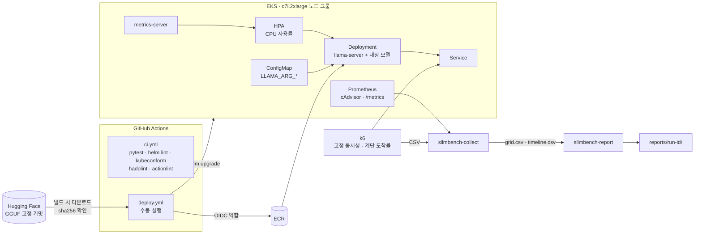

# cpu-sllm-k8s

[](https://github.com/parksungyun0411/cpu-sllm-k8s/actions/workflows/ci.yml) [](LICENSE)

GPU 없는 쿠버네티스에서 4bit 소형 LLM을 llama.cpp 서버로 서빙하고, CPU limit·스레드 수·CFS 스로틀링이 처리량을 얼마나 깎는지와 HPA가 계단 부하에 어떻게 반응하는지 재는 프로젝트다.

> **진행 중.** 코드, 차트, 파이프라인, 측정 도구까지 만들었다. EKS 배포와 측정은 아직 하지 않았다. 아래 결과 표는 모두 비어 있다.

## 배경

GPU 예산이 없거나 망이 분리된 환경에서도 소형 모델을 서빙해야 하는 경우가 있다. 이때 CPU 추론은 쿠버네티스 리소스 설정과 직접 맞물린다.

- CPU 추론은 CPU에 묶여 있어서, HPA의 기본 지표인 CPU 사용률이 실제 부하와 같이 움직인다고 보고 그 관계를 확인한다.
- CPU limit을 스레드 수보다 낮게 주면 CFS 쿼터를 다 쓴 스레드가 주기 끝까지 멈춘다. 이 조합이 처리량에 어떤 영향을 주는지 격자로 잰다.
- 모델 적재에 시간이 걸리므로 startup·readiness 프로브와 롤링 업데이트 설정이 실제로 의미를 가진다.

llama.cpp를 쿠버네티스에 올리는 구성 가이드는 찾았지만, 리소스 제한별 처리량과 HPA 곡선을 실측해 공개한 자료는 찾지 못했다. 찾지 못한 것이지 없다고 확인한 것은 아니다.

## 구성



| 구성 요소 | 내용 |
|---|---|
| 런타임 | llama.cpp `llama-server` 공식 CPU 이미지 `ghcr.io/ggml-org/llama.cpp:server-b11347` (digest 고정) |
| 모델 | [Qwen/Qwen2.5-1.5B-Instruct-GGUF](https://huggingface.co/Qwen/Qwen2.5-1.5B-Instruct-GGUF) `qwen2.5-1.5b-instruct-q4_k_m.gguf`, Apache-2.0, 커밋 `91cad51` 고정 |
| 이미지 | 멀티스테이지 Dockerfile. 1단계에서 모델을 받아 sha256을 확인하고 2단계 서버 이미지에 넣는다 |
| 차트 | `charts/llama-server`: Deployment, Service, ConfigMap, HPA(autoscaling/v2), 선택형 ServiceMonitor |
| 클러스터 | `infra/eksctl/cluster.yaml`: 서울 리전, 1.35, 관리형 노드 그룹 1개, NAT 게이트웨이 없음 |
| 부하 | k6. 격자용 `constant.js`(고정 VU), HPA용 `stepped.js`(계단식 도착률) |
| 측정 | `sllmbench-collect`: kubectl·Prometheus 값을 주기적으로 읽어 k6 결과와 합친다 |
| 리포트 | `sllmbench-report`: CSV를 히트맵·시계열 그림과 표로 바꿔 `reports/`에 둔다 |

## 규모·성능

**측정 전.** EKS에서 측정하면 `reports/<run-id>/REPORT.md`에서 값을 옮겨 채운다.

스레드 × CPU limit 격자 (Guaranteed, 고정 동시성):

| threads \ CPU limit | 1 | 2 | 4 |
|---|---:|---:|---:|
| 1 | | | |
| 2 | | | |
| 4 | | | |
| 8 | | | |

칸마다 생성 tokens/s, CFS 스로틀 비율, p95 지연을 같이 기록한다.

HPA 계단 부하:

| 지표 | 값 |
|---|---:|
| 계단별 Ready 레플리카 수 | |
| 스케일아웃 소요 시간 (HPA 결정 → 파드 Ready) | |
| 계단별 p95 지연 | |
| 계단별 생성 tokens/s | |
| 오류율 | |

## 핵심 설계 판단

- **모델을 이미지에 넣었다.** 폐쇄망을 가정하면 파드가 뜰 때 외부에서 모델을 받을 수 없다. 이미지가 커지는 대신 파드 기동이 외부 네트워크에 의존하지 않는다. 같은 파일이 들어가도록 Hugging Face 커밋과 sha256을 고정했다.
- **llama-server 설정은 ConfigMap의 `LLAMA_ARG_*` 환경변수로 넘긴다.** 격자 실험에서 스레드 수만 바꿔 다시 배포할 수 있고, ConfigMap 체크섬을 파드 어노테이션에 넣어 값이 바뀌면 파드가 새로 뜬다. 환경변수 이름은 고정한 빌드(`b11347`)의 `common/arg.cpp`에서 확인했다. `--threads-batch`는 환경변수가 없어 컨테이너 인자로 넘긴다.
- **프로브를 셋으로 나눴다.** `/health`는 모델 적재 중 503, 준비되면 200을 준다. startupProbe가 최대 300초(5초 × 60회)를 기다리고, 그 뒤에 liveness가 넘겨받는다. 생성 중에 HTTP 응답이 늦어 liveness가 파드를 죽이지 않도록 liveness 타임아웃과 실패 횟수는 readiness보다 넉넉하게 잡았다.
- **롤링 업데이트는 `maxSurge: 1, maxUnavailable: 0`이다.** 새 파드가 Ready가 되기 전에는 기존 파드를 내리지 않는다.
- **HPA 기본값은 requests=limits(Guaranteed)다.** HPA 사용률은 requests 대비 비율이라, requests를 낮게 잡으면 같은 부하에서 사용률이 높게 보인다. Burstable 비교는 `QOS=Burstable`로 따로 돌린다.
- **배포 워크플로는 수동 실행만 받는다.** 클러스터가 있는 시간에만 비용이 들기 때문이다. 장기 액세스 키 대신 GitHub OIDC로 IAM 역할을 맡고, 역할 신뢰 정책은 이 저장소 `main` 브랜치로 제한했다. 쿠버네티스 권한은 `llm` 네임스페이스의 edit으로 묶었다. secret이 없으면 첫 job에서 이유를 출력하고 멈춘다.
- **푸시마다 도는 CI는 클러스터 없이 확인할 수 있는 것만 돈다.** pytest, ruff, `helm lint`, `helm template | kubeconform`(ServiceMonitor는 CRD 카탈로그 스키마로 검사), hadolint, shellcheck, actionlint, `k6 inspect`.
- **서비스는 ClusterIP로 두고 LoadBalancer를 만들지 않았다.** 격자 실험은 port-forward로, HPA 실험은 클러스터 안의 k6 파드에서 서비스로 요청을 보낸다. port-forward는 파드 하나에만 붙기 때문에, 레플리카가 늘어나는 HPA 실험에는 쓰지 않는다.

## 실행 방법

### 로컬에서 확인할 수 있는 것

필요한 도구: uv, helm, kubeconform, hadolint, k6.

```bash
uv sync
uv run pytest -q
helm lint charts/llama-server --strict
helm template llm charts/llama-server | kubeconform -strict -summary -kubernetes-version 1.35.0
hadolint Dockerfile
k6 inspect load/k6/constant.js
```

테스트는 `tests/fixtures/`의 합성 CSV로 수집기와 리포트 생성기의 계산을 검증한다. 합성 데이터는 측정값이 아니며 이 문서의 표에 쓰지 않는다.

### EKS에서 측정하기

준비물: AWS 계정과 관리자 자격 증명, `aws` CLI v2, `eksctl`, `kubectl`, `helm`, `k6`, `uv`. 클러스터를 만들기 전에 [infra/COST.md](infra/COST.md)의 표를 현재 요금표로 채우고 예산 알림을 건다.

```bash
# 1. 클러스터 (metrics-server 애드온 포함)
eksctl create cluster -f infra/eksctl/cluster.yaml

# 2. GitHub OIDC 역할, ECR 저장소, 네임스페이스, EKS 접근 항목
infra/iam/setup-github-oidc.sh
#    출력에 나온 대로 저장소 secret AWS_ROLE_ARN을 넣는다

# 3. 이미지 빌드·푸시·배포
gh workflow run deploy.yml
gh run watch

# 4. Prometheus (cAdvisor 스로틀 지표와 llama-server /metrics 수집)
helm repo add prometheus-community https://prometheus-community.github.io/helm-charts
helm install kps prometheus-community/kube-prometheus-stack -n monitoring --create-namespace \
  -f infra/monitoring/kube-prometheus-stack-values.yaml
kubectl -n monitoring port-forward svc/prometheus-operated 9090:9090 &   # 오퍼레이터가 만드는 서비스

# 5. 실험 (IMAGE_REPO는 ECR 저장소 URI, IMAGE_TAG는 배포한 커밋 SHA)
export IMAGE_REPO=<ecr-repo-uri> IMAGE_TAG=<commit-sha>
scripts/run_grid.sh                    # 스레드 1 2 4 8 × limit 1 2 4, Guaranteed
QOS=Burstable scripts/run_grid.sh      # requests 500m, 같은 격자
scripts/run_hpa.sh                     # experiments/values-hpa.yaml, 계단 부하

# 6. 리포트
uv run sllmbench-report --grid results/<grid-run>/grid.csv --out reports/<grid-run>
uv run sllmbench-report --timeline results/<hpa-run>/timeline.csv --out reports/<hpa-run>

# 7. 그날 정리
infra/teardown.sh          # 클러스터만
infra/teardown.sh --all    # ECR 저장소와 배포 역할까지
```

격자 범위, 동시성, 부하 시간, 계단 값은 환경변수로 바꾼다(`THREADS`, `LIMITS`, `PARALLEL`, `VUS`, `DURATION`, `STEPS`, `STEP_DURATION`). 기본값은 부하 모양을 정하는 입력일 뿐 처리량을 예상한 값이 아니다.

## 재현 (reports/)

측정 한 번이 `reports/<run-id>/` 폴더 하나가 된다. 원자료는 `results/<run-id>/`에 남고 커밋하지 않는다.

| 파일 | 내용 |
|---|---|
| `results/<run-id>/*-k6.csv` | k6 `--out csv` 원자료 |
| `results/<run-id>/*-cluster.csv` | 수집기 샘플: 레플리카, HPA 목표, CPU 코어, 스로틀 비율, 서버 tokens/s, 대기 요청 |
| `results/<run-id>/grid.csv` | 격자 한 칸당 한 줄: threads, cpu_limit, qos, tokens/s, 스로틀 비율, p95, 오류율 |
| `results/<run-id>/timeline.csv` | 15초 구간별: Ready 레플리카, HPA 목표, req/s, p95, tokens/s, 스로틀 비율 |
| `reports/<run-id>/REPORT.md` | 위 CSV로 만든 표와 그림 |

수집기가 쓰는 PromQL은 `src/sllmbench/prom.py`에 있다. 스로틀 비율은 `container_cpu_cfs_throttled_periods_total / container_cpu_cfs_periods_total`의 1분 rate 비율이고, 서버 쪽 처리량은 `llamacpp:tokens_predicted_total`의 rate다.

## 프로젝트 구조

```text
cpu-sllm-k8s/
├── Dockerfile               모델 내장 멀티스테이지 이미지
├── charts/llama-server/     Helm 차트
├── experiments/             실험별 values 덮어쓰기
├── infra/
│   ├── eksctl/              클러스터 설정
│   ├── iam/                 GitHub OIDC 역할·ECR·접근 항목 생성
│   ├── monitoring/          kube-prometheus-stack 값
│   ├── teardown.sh          정리 스크립트
│   └── COST.md              과금 항목과 확인할 요금표
├── load/                    k6 스크립트와 부하용 질문
├── scripts/                 격자·HPA 실험 실행
├── src/sllmbench/           수집기와 리포트 생성기
├── tests/                   pytest와 합성 픽스처
├── reports/                 측정 리포트 (아직 없음)
└── .github/workflows/       ci.yml, deploy.yml
```

## 한계

- EKS 배포, 이미지 빌드, 실험 스크립트는 아직 실행하지 않았다. 로컬에서 확인한 것은 lint, 스키마 검증, 단위 테스트, k6 스크립트 파싱까지다. Docker가 없어 이미지도 로컬에서 빌드해 보지 않았다.
- HPA는 CPU 사용률 한 종류만 구현했다. 대기 요청 수(`llamacpp:requests_deferred`)로 스케일하는 HPA는 Prometheus Adapter나 KEDA가 필요해 넣지 않았다.
- 노드 수는 고정(최대 2대)이고 Cluster Autoscaler·Karpenter를 쓰지 않는다. 노드에 자리가 없으면 HPA가 늘린 파드는 Pending으로 남는다. 측정 곡선은 이 노드 범위 안에서만 의미가 있다.
- 부하용 질문은 직접 쓴 12개다. 공공 FAQ 원문을 쓰지 않았고, 응답 품질은 평가하지 않는다.
- 롤링 업데이트 중 실패 요청 수, 메모리·OOM 경계, EC2·ECS와의 비교는 계획에만 있고 구현하지 않았다.
- 수집기는 15초 간격 샘플이라 그보다 짧은 변화는 잡지 못한다.

## 라이선스

코드는 [MIT](LICENSE) 라이선스를 따른다. 이미지에 넣는 모델 Qwen2.5-1.5B-Instruct-GGUF는 Apache-2.0이며 저장소에는 포함하지 않는다. llama.cpp는 MIT다.
