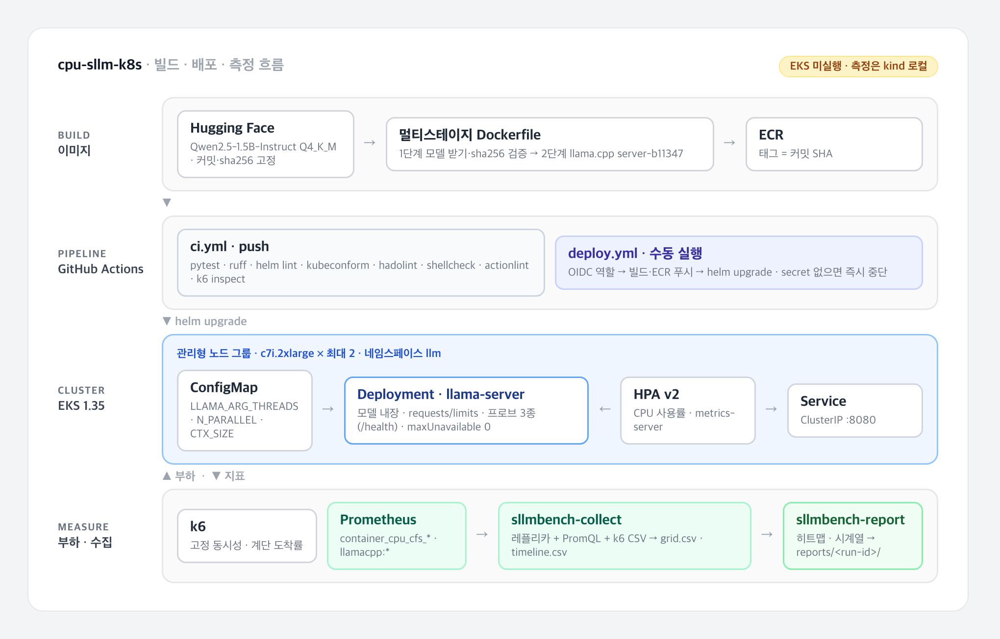

# CPU 전용 쿠버네티스 소형 LLM 서빙

[](https://github.com/parksungyun0411/cpu-sllm-k8s/actions/workflows/ci.yml)   [](LICENSE)

GPU가 없는 쿠버네티스 노드에서 4bit 양자화 소형 LLM을 llama.cpp 서버로 서빙하고, CPU limit·스레드 수·CFS 스로틀링이 생성 처리량을 얼마나 줄이는지, HPA가 계단식 부하에 어떻게 반응하는지 측정하기 위한 프로젝트입니다.

> **측정은 EKS가 아니라 로컬 kind 클러스터에서 했습니다.** Apple M4 MacBook Air의 colima VM(8 vCPU, 8GiB) 위 kind 단일 노드에서 같은 이미지·차트·실험 스크립트로 격자 실험(Guaranteed·Burstable)과 HPA 계단 부하 실험을 실행했고, 결과는 [평가](#평가)에 있습니다. EKS 클러스터 생성, ECR 푸시, IAM·OIDC 스크립트, 배포 워크플로는 작성만 하고 실행하지 않았습니다.

CPU 추론은 GPU 서빙과 쿠버네티스 설정이 맞물리는 방식이 다릅니다. 추론이 CPU에 묶여 있으므로 HPA의 기본 지표인 CPU 사용률이 실제 부하를 따라가는지 확인할 수 있고, CPU limit을 스레드 수보다 낮게 주면 CFS 쿼터를 소진한 스레드가 주기 끝까지 멈추기 때문에 requests·limits 설정이 처리량 차이로 드러납니다. 모델 적재에도 시간이 걸려 startup·readiness 프로브와 롤링 업데이트 설정이 실제 동작에 영향을 줍니다. 이 세 가지를 같은 이미지와 같은 부하 조건에서 수치로 비교하는 것이 목표입니다.

## 구현 범위

- 멀티스테이지 Dockerfile: 1단계에서 GGUF 모델을 Hugging Face 고정 커밋에서 받아 sha256을 검증하고, 2단계에서 llama.cpp 공식 CPU 서버 이미지(digest 고정)에 넣어 외부 네트워크 없이 기동되는 이미지 구성
- Helm 차트 `charts/llama-server`: Deployment, Service, ConfigMap(`LLAMA_ARG_*`), requests·limits, 모델 적재 시간을 고려한 startup·readiness·liveness 프로브, `autoscaling/v2` HPA, 선택형 ServiceMonitor
- eksctl 클러스터 설정(관리형 노드 그룹 1개, NAT 게이트웨이 없음, metrics-server 애드온)과 정리 스크립트, 과금 항목 메모
- GitHub OIDC 역할·ECR 저장소·EKS 접근 항목 생성 스크립트(계정 ID는 실행 시 조회, 저장소에 기록하지 않음)
- GitHub Actions: push마다 도는 CI(pytest, ruff, `helm lint`, `helm template | kubeconform`, hadolint, shellcheck, actionlint, `k6 inspect`)와 수동 실행 전용 배포 워크플로(빌드 → ECR 푸시 → Helm 배포)
- k6 부하 스크립트: 격자 실험용 고정 동시성(`constant.js`), HPA 실험용 계단식 도착률(`stepped.js`)
- 측정 수집기 `sllmbench-collect`: kubectl 레플리카 상태와 Prometheus 질의(CFS 스로틀 비율, CPU 사용량, 서버 측 생성 토큰 처리량, 대기 요청 수)를 주기적으로 기록하고 k6 결과와 시간축으로 병합해 CSV 생성
- 리포트 생성기 `sllmbench-report`: CSV를 히트맵·시계열 그림과 Markdown 표로 변환해 `reports/<run-id>/`에 저장
- 스레드 × CPU limit 격자 실험과 HPA 계단 부하 실험 실행 스크립트, 실행 조건(버전·노드·이미지·배포 값)을 명령 출력에서 읽어 리포트에 넣는 `scripts/run_conditions.sh`, macOS 호스트의 잠자기 기록을 남기는 `scripts/host_power.sh`
- 로컬 측정 경로: kind 단일 노드 설정, 이미지 빌드·`kind load`·metrics-server·Prometheus 설치 스크립트, 노드 크기에 맞춘 values 덧붙이기(`experiments/values-kind.yaml`)

## 아키텍처



다이어그램 원본은 [docs/diagrams/architecture.html](docs/diagrams/architecture.html)입니다. 다이어그램은 EKS 배포를 기준으로 그린 설계이며, 실제 측정은 같은 이미지·차트·스크립트를 kind 단일 노드에서 돌려 얻었습니다.

| 단계 | 구성 | 근거 파일 |
|---|---|---|
| 이미지 | Qwen2.5-1.5B-Instruct Q4_K_M + `ghcr.io/ggml-org/llama.cpp:server-b11347` | [Dockerfile](Dockerfile) |
| 배포 | Helm 차트, 릴리스 이름 `llm`, 네임스페이스 `llm` | [charts/llama-server/](charts/llama-server/) |
| 클러스터(측정) | kind 단일 노드, macOS(Apple M4)의 colima VM(8 vCPU, 8GiB) | [infra/kind/](infra/kind/) |
| 클러스터(미실행) | EKS 1.35, 서울 리전, `c7i.2xlarge` 관리형 노드 그룹(최대 2대) | [infra/eksctl/cluster.yaml](infra/eksctl/cluster.yaml) |
| 부하 | k6 고정 동시성(port-forward) · 계단식 도착률(클러스터 내부 파드 → Service) | [load/k6/](load/k6/) |
| 수집 | cAdvisor `container_cpu_cfs_*`, llama-server `llamacpp:*`, kubectl 레플리카 | [src/sllmbench/prom.py](src/sllmbench/prom.py) |

## 기술 스택

| 영역 | 기술 |
|---|---|
| 추론 런타임 |   |
| 컨테이너·오케스트레이션 |      |
| 클라우드 |    |
| CI/CD |  |
| 부하·관측 |   |
| 분석·리포트 |    |
| 코드 품질 |     |

## 실행 방법

### 로컬 검증

클러스터 없이 확인할 수 있는 범위입니다. 필요한 도구는 uv, helm, kubeconform, hadolint, k6입니다.

```bash
uv sync
uv run pytest -q
helm lint charts/llama-server --strict
helm template llm charts/llama-server | kubeconform -strict -summary -kubernetes-version 1.35.0
hadolint Dockerfile
k6 inspect load/k6/constant.js
```

테스트는 `tests/fixtures/`의 합성 CSV로 수집기와 리포트 생성기의 계산을 검증합니다. 합성 데이터는 손으로 검산할 수 있게 만든 값이며 측정 결과가 아닙니다.

### kind 측정 (로컬, 이 저장소의 결과를 낸 경로)

필요한 것은 docker 엔진(macOS는 colima), kind, kubectl, helm, k6, uv입니다. 아래 평가의 결과는 이 경로로 얻었습니다.

```bash
# 1. VM과 클러스터. kind 노드 하나가 VM의 vCPU·메모리를 그대로 씁니다.
colima start --cpu 8 --memory 8 --disk 40 --vm-type vz
infra/kind/setup.sh        # kind 클러스터 → 이미지 빌드·kind load → metrics-server → kube-prometheus-stack
                           # Prometheus는 NodePort로 http://localhost:9090 에 열립니다

# 2. 실험. experiments/values-kind.yaml이 레지스트리 없이 노드 이미지를 쓰고 노드 크기에 맞춥니다.
#    macOS가 잠자기에 들어가면 VM과 k6가 함께 멈추므로 caffeinate로 막습니다.
export IMAGE_REPO=cpu-sllm-k8s IMAGE_TAG=kind EXTRA_VALUES=experiments/values-kind.yaml
QOS=Guaranteed RUN_ID=grid-guaranteed-<UTC 시각> caffeinate -dims scripts/run_grid.sh
QOS=Burstable  RUN_ID=grid-burstable-<UTC 시각>  caffeinate -dims scripts/run_grid.sh
caffeinate -dims scripts/run_hpa.sh                          # 기본 STEPS=6,12,18,24
STEPS=20,40,60,80 RUN_ID=hpa-steps20-<UTC 시각> caffeinate -dims scripts/run_hpa.sh

# 3. 리포트 (스크립트가 끝에 정확한 명령을 출력합니다)
uv run sllmbench-report --grid results/<run>/grid.csv --conditions results/<run>/conditions.md --out reports/<run>
uv run sllmbench-report --timeline results/<run>/timeline.csv --steps results/<run>/steps.csv \
  --scale results/<run>/scale.csv --conditions results/<run>/conditions.md --out reports/<run>

# 4. 정리
kind delete cluster --name cpu-sllm
colima stop
```

`experiments/values-kind.yaml`이 차트 기본값에서 바꾸는 것은 네 가지입니다. 이미지를 `kind load`로 넣으므로 `pullPolicy: Never`, 노드 메모리가 8GiB라 3Gi 요청 파드는 2개까지만 스케줄되므로 메모리 요청·제한을 2Gi로, 4코어 파드 둘이 한 노드에 함께 뜰 수 없어 롤링 업데이트를 `maxSurge: 0`, `maxUnavailable: 1`로, 2코어 파드 4개(8코어)는 시스템 파드 요청을 뺀 노드에 들어가지 않아 HPA `maxReplicas`를 4에서 3으로 줄였습니다. `maxReplicas`를 4로 두면 네 번째 파드는 Pending으로 남고, 곡선은 그 지점에서 노드 크기에 막힙니다.

### EKS 측정 (작성만 하고 실행하지 않음)

아래 경로는 스크립트와 설정만 있고 한 번도 실행하지 않았습니다. 필요한 것은 AWS 계정과 관리자 자격 증명, aws CLI v2, eksctl, kubectl, helm, k6, uv입니다. 클러스터를 만들기 전에 [infra/COST.md](infra/COST.md)의 단가 칸을 현재 공식 요금표로 채우고 예산 알림을 걸어 둡니다.

```bash
# 1. 클러스터 생성 (metrics-server 애드온 포함)
eksctl create cluster -f infra/eksctl/cluster.yaml

# 2. GitHub OIDC 역할, ECR 저장소, 네임스페이스, EKS 접근 항목 생성
infra/iam/setup-github-oidc.sh
#    출력 안내에 따라 저장소 secret AWS_ROLE_ARN 등록

# 3. 이미지 빌드·ECR 푸시·배포 (수동 실행)
gh workflow run deploy.yml
gh run watch

# 4. Prometheus 설치와 포트 포워딩
helm repo add prometheus-community https://prometheus-community.github.io/helm-charts
helm install kps prometheus-community/kube-prometheus-stack -n monitoring --create-namespace \
  -f infra/monitoring/kube-prometheus-stack-values.yaml
kubectl -n monitoring port-forward svc/prometheus-operated 9090:9090 &

# 5. 실험 (IMAGE_REPO는 ECR 저장소 URI, IMAGE_TAG는 배포한 커밋 SHA)
export IMAGE_REPO=<ecr-repo-uri> IMAGE_TAG=<commit-sha>
scripts/run_grid.sh                    # threads 1 2 4 8 × CPU limit 1 2 4, Guaranteed
QOS=Burstable scripts/run_grid.sh      # requests 500m, 같은 격자
scripts/run_hpa.sh                     # experiments/values-hpa.yaml, 계단 부하

# 6. 리포트 생성
uv run sllmbench-report --grid results/<grid-run>/grid.csv --out reports/<grid-run>
uv run sllmbench-report --timeline results/<hpa-run>/timeline.csv --out reports/<hpa-run>

# 7. 당일 정리
infra/teardown.sh          # 클러스터 삭제
infra/teardown.sh --all    # ECR 저장소와 배포 역할까지 삭제
```

격자 범위와 부하 조건은 환경변수로 바꿉니다.

| 실험 | 환경변수 |
|---|---|
| 격자 | `THREADS`, `LIMITS`, `QOS`, `REQUEST_CPU`, `PARALLEL`, `VUS`, `DURATION` |
| HPA | `STEPS`(분당 요청 수), `STEP_DURATION` |

스크립트의 기본값은 부하 모양을 정하는 입력이며, 처리 가능량을 예상한 값이 아닙니다.

## 평가

모든 값은 아래 환경에서 실행해 얻었고(격자는 칸마다 한 번, 그중 네 칸은 재실행), 각 표 아래에 출처 `reports/<run-id>/REPORT.md`를 적었습니다. EKS가 아니라 노트북 한 대 위의 kind 클러스터에서 낸 값이므로 클라우드 노드의 절대 성능으로 읽으면 안 됩니다.

**측정 환경**: kind v0.33.0 단일 노드(Kubernetes v1.37.0, containerd 2.3.4, arm64, 커널 6.8.0-117-generic), colima 0.10.3 VM(macOS Virtualization.Framework, vCPU 8, 메모리 8GiB), 호스트 MacBook Air(Mac16,13, Apple M4 성능 코어 4 + 효율 코어 6, 메모리 16GiB, macOS 26.6.2). kubelet `cpuManagerPolicy`는 `none`, CFS 주기 100ms입니다. 이미지는 `ghcr.io/ggml-org/llama.cpp:server-b11347@sha256:970168341efe…`(llama-server build 11347, commit 5fc4f3c8c)에 Qwen2.5-1.5B-Instruct Q4_K_M을 넣은 것이고, Prometheus는 kube-prometheus-stack 92.3.1, metrics-server는 차트 3.14.0(0.9.0), 부하는 같은 Mac에서 k6 v2.3.0으로 걸었습니다. 버전과 배포 값의 원문은 각 `REPORT.md`의 실행 조건에, 실행 구간에 호스트가 잠자기에 들어가지 않았다는 기록은 같은 폴더의 `host-power.txt`에 있습니다.

### 스레드 × CPU limit 격자

칸마다 3분 동안 동시 요청 2개(`VUS=2`, 슬롯 `PARALLEL=2`)를 유지했습니다. Guaranteed는 requests = limits, Burstable은 requests 500m에 같은 limit입니다. 표의 각 칸은 `Guaranteed / Burstable` 순서입니다. 12칸 × 2회 모두 오류율은 0이었습니다.

생성 tokens/s(k6가 받은 `usage.completion_tokens` 합 ÷ 실행 시간):

| threads \ CPU limit | 1 | 2 | 4 |
|---|---:|---:|---:|
| 1 | 28.16 / 27.19 | 27.77 / 27.34 | 27.51 / 26.79 |
| 2 | 26.50 / 26.04 | 42.59 / 39.55 | 40.27 / 40.01 |
| 4 | 16.44 / 16.15 | 37.09 / 36.72 | 50.88 / 52.02 |
| 8 | 7.10 / 7.23 | 22.06 / 21.34 | 45.27 / 45.62 |

CFS 스로틀 비율(스로틀된 주기 ÷ 전체 주기, 부하 시작 1분 뒤부터의 샘플 평균):

| threads \ CPU limit | 1 | 2 | 4 |
|---|---:|---:|---:|
| 1 | 0.219 / 0.194 | 0.000 / 0.000 | 0.000 / 0.000 |
| 2 | 0.878 / 0.883 | 0.182 / 0.200 | 0.000 / 0.000 |
| 4 | 0.999 / 1.000 | 0.995 / 1.000 | 0.021 / 0.100 |
| 8 | 0.999 / 0.997 | 0.988 / 0.995 | 0.983 / 0.997 |

요청 p95 지연(ms):

| threads \ CPU limit | 1 | 2 | 4 |
|---|---:|---:|---:|
| 1 | 7612 / 7886 | 7575 / 7407 | 7975 / 8335 |
| 2 | 7903 / 8222 | 5313 / 5583 | 5389 / 5585 |
| 4 | 12875 / 13407 | 5348 / 5944 | 4218 / 4258 |
| 8 | 28228 / 30802 | 9738 / 10409 | 4706 / 4691 |

출처: [reports/grid-guaranteed-20261014T0334Z/REPORT.md](reports/grid-guaranteed-20261014T0334Z/REPORT.md), [reports/grid-burstable-20261014T0413Z/REPORT.md](reports/grid-burstable-20261014T0413Z/REPORT.md)

표에서 읽을 수 있는 것은 다음과 같습니다. 아래 [같은 칸 재실행](#같은-칸-재실행)에서 같은 설정의 처리량이 최대 15.5% 달라졌으므로, 그보다 큰 차이만 결론으로 적었습니다.

- 스레드 수가 CPU limit을 넘으면 스로틀 비율이 0.878~1.000으로 올라가고, 같은 limit에서 스레드를 늘릴수록 처리량이 줄었습니다. limit 1에서 1·2·4·8 스레드가 Guaranteed 28.16 → 26.50 → 16.44 → 7.10, Burstable 27.19 → 26.04 → 16.15 → 7.23 tokens/s였고, p95는 Guaranteed 7612 → 28228ms였습니다. limit 2에서도 8 스레드는 2 스레드의 절반 수준이었습니다(22.06 / 21.34 대 42.59 / 39.55).
- 1 스레드는 limit을 1·2·4로 늘려도 26.79~28.16 tokens/s로 거의 같았습니다. limit을 올려도 스레드를 늘리지 않으면 처리량이 늘지 않았습니다.
- 2 스레드에 limit 2 이상을 주면 1 스레드보다 높았습니다(36.37~42.59, 재실행 포함). 4 스레드·limit 4는 1회차(50.88)와 Burstable(52.02)에서는 2 스레드보다 높았지만 재실행(43.08)에서는 2 스레드·limit 2(41.68)와 거의 같아, 4 스레드로 얼마나 더 오르는지는 이 측정으로 말할 수 없습니다. limit 4에서 8 스레드가 4 스레드보다 낮았던 것(45.27 대 50.88, 45.62 대 52.02)도 차이가 잡음 범위 안입니다.
- 스레드 수와 limit이 같은 칸에서도 스로틀이 0이 아니었습니다(1·1에서 0.219 / 0.194, 2·2에서 0.182 / 0.200). 생성 스레드 외의 서버 스레드(HTTP 처리 등)가 같은 쿼터를 쓰기 때문으로 보이지만 확인하지는 않았습니다.
- Guaranteed와 Burstable의 tokens/s 차이는 가장 큰 칸이 2 스레드·limit 2(42.59 / 39.55)로 약 7%였고, 어느 쪽이 높은지도 칸마다 달랐습니다. 이 실험에서는 노드에 다른 CPU 부하가 없어 requests(CPU 가중치)가 작용할 상황이 없었고, 두 QoS가 같은 CFS 쿼터(limit)를 받았습니다. 따라서 이 결과는 "경합이 없으면 QoS 클래스에 따른 차이가 측정 잡음보다 작았다"까지만 말하며, 경합 상황의 차이는 측정하지 않았습니다.

### 같은 칸 재실행

격자의 각 칸은 한 번씩만 돌렸기 때문에, 처리량이 높은 네 칸(Guaranteed, threads 2·4 × limit 2·4)을 1회차보다 약 2시간 45분 뒤에 같은 스크립트로 다시 돌렸습니다. 생성 tokens/s:

| threads · limit | 1회차 | 재실행 |
|---|---:|---:|
| 2 · 2 | 42.59 | 41.68 |
| 2 · 4 | 40.27 | 36.37 |
| 4 · 2 | 37.09 | 31.34 |
| 4 · 4 | 50.88 | 43.08 |

출처: [reports/grid-guaranteed-20261014T0334Z/REPORT.md](reports/grid-guaranteed-20261014T0334Z/REPORT.md), [reports/grid-guaranteed-repeat-20261014T0619Z/REPORT.md](reports/grid-guaranteed-repeat-20261014T0619Z/REPORT.md)

같은 설정인데 재실행 값이 최대 15.5% 낮았습니다(4·2에서 37.09 → 31.34, 4·4에서 50.88 → 43.08은 15.3%). 호스트는 팬이 없는 MacBook Air(Mac16,13)이고, pmset 로그상 1회차와 Burstable 격자는 덮개를 닫고 전원을 연결한 상태(Clamshell Sleep 뒤 DarkWake)에서, 재실행은 덮개를 연 뒤에 돌았습니다(각 리포트 폴더의 `host-power.txt`). 발열에 따른 클럭 변화는 측정하지 않아 원인을 가리지 못했습니다. 따라서 위 격자에서 이보다 작은 차이(2 스레드에서 limit 2와 4의 차이, Guaranteed와 Burstable의 차이 등)는 이 측정으로 구분할 수 없고, limit 1에서 스레드를 1개에서 8개로 늘렸을 때 처리량이 약 4분의 1로 떨어진 것처럼 큰 차이만 말할 수 있습니다.

### HPA 계단 부하

`experiments/values-hpa.yaml`(threads 2, 슬롯 2, CPU requests = limits = 2, 목표 사용률 70%)에 kind 덧붙이기(`maxReplicas` 3)로 배포하고, 클러스터 안의 k6 파드가 Service로 분당 요청 수를 계단식으로 올렸습니다. 계단마다 10초 램프 뒤 4분을 유지하고, 마지막에 첫 계단 부하로 6분을 둡니다. 표의 값은 램프를 뺀 각 계단 구간에 완료된 요청 기준이고, CPU는 그 구간 수집기 샘플의 평균(파드 합)입니다.

**기본 계단(분당 6, 12, 18, 24 요청)**

| 계단(분당 요청) | 완료(분당) | Ready 레플리카(시작 → 끝) | CPU(코어) | p95(ms) | tokens/s | 오류율 |
|---|---:|---:|---:|---:|---:|---:|
| 6 | 6.2 | 1 → 1 | 0.22 | 2204 | 6.56 | 0.000 |
| 12 | 12.0 | 1 → 1 | 0.49 | 2308 | 11.43 | 0.000 |
| 18 | 18.2 | 1 → 1 | 0.66 | 2264 | 15.83 | 0.000 |
| 24 | 23.8 | 1 → 1 | 0.84 | 2284 | 19.70 | 0.000 |
| 6(마무리) | 6.0 | 1 → 1 | 0.31 | 2196 | 5.96 | 0.000 |

출처: [reports/hpa-20261014T0555Z/REPORT.md](reports/hpa-20261014T0555Z/REPORT.md)

가장 높은 계단에서도 CPU가 평균 0.84코어로 requests(2코어)의 70%에 못 미쳐, HPA는 레플리카를 한 번도 늘리지 않았습니다. 기본 계단은 부하 모양을 정하려고 측정 전에 정한 입력이었고, 이 구성에서는 스케일아웃을 일으키지 못하는 부하였습니다.

**계단을 올린 실행(분당 20, 40, 60, 80 요청)**

기본 계단에서 스케일아웃이 일어나지 않아, 위 CPU 사용량을 보고 계단만 높여 한 번 더 돌렸습니다(`STEPS=20,40,60,80`, 나머지 조건 같음). 이 값도 부하 모양을 정한 입력이며 처리 가능량을 예측한 값이 아닙니다. 모든 계단에서 오류율은 0이었습니다.

| 계단(분당 요청) | 완료(분당) | 건너뜀 | Ready 레플리카(시작 → 끝) | CPU(코어) | p95(ms) | tokens/s | 대기 요청 최대 |
|---|---:|---:|---:|---:|---:|---:|---:|
| 20 | 20.0 | 0 | 1 → 1 | 0.76 | 2420 | 19.29 | 0 |
| 40 | 40.0 | 0 | 1 → 3 | 2.62 | 7330 | 35.40 | 0 |
| 60 | 54.0 | 3 | 3 → 3 | 4.79 | 29855 | 49.20 | 15 |
| 80 | 55.5 | 49 | 3 → 3 | 5.74 | 77693 | 50.74 | 64 |
| 20(마무리) | 32.0 | 0 | 3 → 3 | 3.12 | 109774 | 29.86 | 67 |

스케일 시점(부하 시작 기준, HPA `lastScaleTime`과 파드 생성·Ready 시각으로 계산):

| 부하 시작 후(초) | 레플리카 | HPA 목표 변경 → 파드 생성(초) | HPA 목표 변경 → 파드 Ready(초) |
|---:|---:|---:|---:|
| 308 | 1 → 2 | 0 | 5 |
| 413 | 2 → 3 | 0 | 15 |

출처: [reports/hpa-steps20-20261014T0634Z/REPORT.md](reports/hpa-steps20-20261014T0634Z/REPORT.md)

- 두 번의 스케일아웃 모두 분당 40 계단에서 일어났습니다. 첫 번째는 40 계단 램프가 시작된 250초에서 58초 뒤였고, HPA가 목표를 바꾼 뒤 새 파드가 Ready가 되기까지 5초와 15초가 걸렸습니다. 시각이 모두 초 단위라 값마다 1초 안팎의 오차가 있습니다. kind에서는 이미지를 노드에 미리 넣어 두었으므로(`pullPolicy: Never`) 이 시간에는 이미지 내려받기가 들어 있지 않습니다.
- 분당 60·80 계단에서는 레플리카 3개(최대)가 모두 Ready였는데도 완료가 분당 54.0, 55.5에 그쳤고, 대기 요청이 쌓여 p95가 29855ms, 77693ms까지 올랐습니다. 80 계단에서는 k6가 요청 49건을 보낼 VU를 제때 만들지 못해 건너뛰었으므로(`dropped_iterations`), 실제로 보낸 부하도 분당 80보다 적었습니다.
- 이때 세 파드의 총 생성 처리량(49.20, 50.74 tokens/s)은 격자에서 파드 하나가 4 스레드·limit 4로 낸 값(50.88 / 52.02)과 비슷했습니다. 세 파드가 같은 노드의 vCPU 8개를 나눠 쓰므로, 이 환경에서는 레플리카를 늘려도 노드 전체 처리량이 늘지 않은 것으로 보입니다. 성능 코어 수 때문인지 메모리 대역폭 때문인지 같은 원인은 확인하지 않았습니다.
- 마무리 구간(분당 20)에서는 쌓인 요청을 처리하느라 완료가 분당 32.0으로 보낸 양보다 많았고, 6분 동안 축소는 일어나지 않았습니다(축소 안정화 시간 300초).


### 산출물 규칙

측정 한 번이 `reports/<run-id>/` 폴더 하나가 됩니다. 원자료는 `results/<run-id>/`에 남고 커밋하지 않습니다. 자세한 규칙은 [reports/README.md](reports/README.md)에 있습니다.

| 파일 | 내용 |
|---|---|
| `results/<run-id>/*-k6.csv` | k6 `--out csv` 원자료 |
| `results/<run-id>/*-cluster.csv` | 수집기 샘플: 레플리카, HPA 목표, CPU 코어, 스로틀 비율, 서버 tokens/s, 대기 요청 |
| `results/<run-id>/grid.csv` | 격자 한 칸당 한 줄: threads, cpu_limit, qos, tokens/s, 스로틀 비율, p95, 오류율 |
| `results/<run-id>/timeline.csv` | 15초 구간별: Ready 레플리카, HPA 목표, req/s, p95, tokens/s, 스로틀 비율 |
| `results/<run-id>/steps.csv` | HPA 계단마다 한 줄: 완료 요청 수, p95, tokens/s, 레플리카, CPU, 스로틀 비율 |
| `results/<run-id>/hpa-watch.txt`, `pods-watch.txt`, `scale.csv` | HPA·파드 상태 변화 기록과, 그것으로 계산한 스케일 시점·파드 Ready까지 걸린 시간 |
| `results/<run-id>/conditions.md` | `scripts/run_conditions.sh`가 남긴 실행 조건 |
| `reports/<run-id>/REPORT.md` | 실행 조건과 위 CSV로 만든 표·그림 |
| `reports/<run-id>/host-power.txt` | 실행 구간 앞뒤의 macOS 잠자기·깨어남 기록(`pmset -g log` 발췌) |

스로틀 비율은 `container_cpu_cfs_throttled_periods_total`과 `container_cpu_cfs_periods_total`의 1분 rate 비율, CPU 사용량은 `container_cpu_usage_seconds_total`의 1분 `deriv`, 서버 측 처리량은 `llamacpp:tokens_predicted_total`의 rate입니다. 질의 원문은 [src/sllmbench/prom.py](src/sllmbench/prom.py)에 있습니다.

## 프로젝트 구조

```text
cpu-sllm-k8s/
├── Dockerfile              모델 내장 멀티스테이지 이미지
├── charts/llama-server/    Helm 차트
├── experiments/            실험별 values 덮어쓰기
├── infra/
│   ├── kind/               로컬 측정용 kind 클러스터 설정과 셋업 스크립트
│   ├── eksctl/             EKS 클러스터 설정(미실행)
│   ├── iam/                GitHub OIDC 역할·ECR·접근 항목 생성
│   ├── monitoring/         kube-prometheus-stack 값(공통, kind 덧붙이기)
│   ├── teardown.sh         정리 스크립트
│   └── COST.md             과금 항목과 확인할 요금표
├── load/                   k6 스크립트와 부하용 질문
├── scripts/                격자·HPA 실험 실행, 실행 조건 기록
├── src/sllmbench/          수집기와 리포트 생성기
├── tests/                  단위 테스트와 합성 픽스처
├── reports/                측정 리포트(실행 하나당 폴더 하나)
├── docs/diagrams/          아키텍처 다이어그램(HTML 원본·PNG)
└── .github/workflows/      ci.yml, deploy.yml
```

## 구현하면서 신경 쓴 점

- 모델은 런타임 다운로드 대신 이미지에 넣었습니다. 망이 분리된 환경에서는 파드 기동 시 외부에서 모델을 받을 수 없기 때문입니다. 이미지 크기가 커지는 비용을 감수하고, 같은 파일이 들어가도록 Hugging Face 커밋과 sha256을 고정했습니다. 베이스 이미지 digest는 `server-b11347` 태그의 멀티 아키텍처 인덱스 digest와 같고 linux/amd64·linux/arm64 매니페스트를 모두 담고 있음을 `docker buildx imagetools inspect`로 확인했으며, 빌드 때 모델 sha256 검사를 통과했습니다.
- llama-server 설정은 ConfigMap의 `LLAMA_ARG_*` 환경변수로 넘깁니다. 격자 실험에서 스레드 수만 바꿔 재배포할 수 있고, ConfigMap 체크섬을 파드 어노테이션에 넣어 값이 바뀌면 파드가 새로 뜹니다. 환경변수 이름은 고정한 빌드(`b11347`)의 `common/arg.cpp`에서 확인했고 빌드한 이미지의 `llama-server --help`로 다시 확인했으며, `--threads-batch`는 대응하는 환경변수가 없어 컨테이너 인자로 넘깁니다.
- 프로브는 역할을 나눴습니다. llama-server의 `/health`는 모델 적재 중 503, 준비 후 200을 반환합니다. startupProbe가 `values.yaml` 기준 최대 300초(5초 × 60회)까지 기다린 뒤 liveness가 넘겨받고, 생성 중 HTTP 응답이 늦어 파드가 재시작되지 않도록 liveness의 타임아웃과 실패 허용 횟수를 readiness보다 넉넉하게 잡았습니다.
- 롤링 업데이트는 `maxSurge: 1`, `maxUnavailable: 0`으로 두어 새 파드가 Ready가 되기 전에 기존 파드를 내리지 않습니다. kind 단일 노드에서는 4코어 파드 둘이 함께 뜰 자리가 없어 `experiments/values-kind.yaml`이 이를 `maxSurge: 0`, `maxUnavailable: 1`로 바꿉니다.
- HPA 실험의 기본 설정은 requests와 limits를 같게 둔 Guaranteed입니다. HPA 사용률은 requests 대비 비율이라 requests를 낮추면 같은 부하에서도 사용률이 높게 계산되므로, Burstable 비교는 별도 실행으로 분리했습니다.
- 배포 워크플로는 `workflow_dispatch`로만 실행됩니다. 클러스터가 떠 있는 시간에만 비용이 생기기 때문입니다. 장기 액세스 키 대신 GitHub OIDC로 IAM 역할을 맡고, 신뢰 정책은 이 저장소의 `main` 브랜치로, 쿠버네티스 권한은 `llm` 네임스페이스의 edit으로 제한했습니다. secret이 없으면 첫 job에서 이유를 출력하고 중단합니다.
- 서비스는 ClusterIP로 두고 LoadBalancer를 만들지 않았습니다. port-forward는 파드 하나에만 연결되므로, 레플리카가 늘어나는 HPA 실험은 클러스터 안에서 k6 파드를 띄워 Service로 요청을 보냅니다.

## 실행하면서 고친 것

작성만 해 두었던 스크립트를 처음 실행하면서 다음 문제를 찾아 고쳤습니다. 측정값은 모두 고친 뒤의 코드로 냈습니다.

- 수집기의 격자 요약이 부하 시작 직후 샘플까지 평균했습니다. 그 샘플의 1분 rate 창에는 부하 전 유휴 구간이 섞여 스로틀 비율과 CPU 사용량이 낮게 나옵니다. rate 창이 부하 구간 안에 다 들어온 샘플만 쓰도록 바꿨습니다.
- CPU 사용 코어 수를 `rate()`로 구했는데, cAdvisor 샘플이 10~20초 간격으로 고르지 않아 창 끝 외삽이 줄어들면서 limit까지 쓰던 파드의 사용량이 실제보다 낮게 찍혔습니다. 창 안 샘플의 기울기인 `deriv()`로 바꿨습니다. 스로틀 비율은 분자·분모가 같은 샘플 시각을 쓰므로 영향이 없었습니다.
- HPA 실험의 k6 파드에서 `workingDir`를 emptyDir 아래로 잡아 런타임이 그 디렉터리를 root 소유로 만들었고, k6 사용자가 스크립트를 복사하지 못했습니다. 결과 파일을 기다리는 루프에는 빠져나갈 조건이 없어 스크립트가 끝나지 않았습니다. `cd`로 옮기고, k6 종료 코드 파일을 기다리며, 파드가 먼저 끝나면 로그를 남기고 중단하게 했습니다.
- 격자 스크립트가 부하 중 실패하면 수집기 프로세스가 남아 돌았습니다. 종료 시 함께 정리합니다.
- 리포트에 HPA 계단별 요약과 스케일아웃 소요 시간이 없어 평가 표를 채울 수 없었습니다. 수집기에 `steps`, `scale`을 추가했고, 15초 샘플로는 파드가 Ready가 되는 시각을 잡을 수 없어 HPA와 파드의 상태 변화를 `kubectl --watch`로 따로 기록합니다.
- 실행 조건을 `REPORT.md`에 손으로 덧붙이던 규칙을 바꿔, `scripts/run_conditions.sh`가 명령 출력에서 읽어 남기고 리포트 생성기가 그대로 넣게 했습니다.
- 격자 실험 직후 HPA 실험을 시작하면 직전 파드의 CPU 사용량이 메트릭에 남아 HPA가 부하 전에 레플리카를 2개로 늘려 두었습니다. 레플리카와 HPA 목표가 `minReplicas`로 돌아온 뒤에 부하를 시작하도록 했고, 그 상태로 시작한 실행은 버리고 다시 돌렸습니다.
- 첫 HPA 실행(`hpa-20261014T0452Z`) 도중 macOS가 잠자기에 들어가 VM과 k6가 몇 분씩 멈췄습니다. 멈춘 시간이 요청 지연과 HPA의 반응에 그대로 섞여 이 실행은 결과에서 뺐습니다. 이후 실행은 `caffeinate`로 잠자기를 막았고, 각 리포트 폴더의 `host-power.txt`(pmset 로그 발췌)로 실행 구간에 잠자기가 없었음을 남겼습니다.

## 한계

- EKS 경로는 작성만 하고 실행하지 않았습니다. eksctl 클러스터 생성, ECR 푸시, GitHub OIDC 역할 생성 스크립트(`infra/iam/setup-github-oidc.sh`), 배포 워크플로(`deploy.yml`), 정리 스크립트(`infra/teardown.sh`)는 한 번도 돌리지 않았고, `c7i.2xlarge`의 서울 리전 제공 여부와 요금도 확인하지 않았습니다. 이 저장소의 측정값은 EKS 노드 성능을 대신하지 않습니다.
- 측정은 노트북 한 대 위의 kind 단일 노드에서 했습니다. VM의 vCPU 8개는 물리 코어에 고정되지 않고 macOS가 성능 코어 4개와 효율 코어 6개 사이에서 스케줄합니다. 4개를 넘는 vCPU가 동시에 바쁘면 일부는 효율 코어에서 돌 수 있어, 4·8 스레드 칸과 레플리카 3개 구간은 코어 종류가 섞인 결과일 수 있습니다.
- CPU는 arm64(Apple M4)이고 llama.cpp는 NEON 경로로 돌았습니다. x86 노드(AVX2·AVX-512)에서는 절대 처리량과 스레드별 증가 폭이 다를 수 있습니다.
- 부하 발생기도 같은 머신에서 돌았습니다. 격자는 macOS의 k6가 `kubectl port-forward`로, HPA는 같은 노드의 k6 파드(BestEffort)가 Service로 요청을 보냈습니다. 측정 중 macOS에서 브라우저 등 다른 앱이 계속 실행 중이었고 이를 통제하지 않았습니다.
- 격자의 각 칸은 한 번씩만 실행했습니다. 네 칸을 다시 돌렸을 때 같은 설정에서 처리량이 최대 15.5% 달라졌으므로, 그보다 작은 차이는 측정 잡음과 구분되지 않습니다. 호스트가 팬 없는 노트북이라 발열에 따른 클럭 변화가 섞였을 수 있으나 측정하지 않았습니다(`powermetrics`는 관리자 권한이 필요해 쓰지 않았습니다).
- Guaranteed와 Burstable은 노드에 다른 CPU 부하가 없는 상태에서만 비교했습니다. requests(CPU 가중치)는 경합이 있을 때만 작용하므로, 경합 상황에서 QoS 클래스가 만드는 차이는 이 저장소가 보여 주지 않습니다. Guaranteed 파드도 kubelet `cpuManagerPolicy: none`이라 전용 코어를 받지 않았습니다.
- 부하는 직접 작성한 질문 12개를 `temperature: 0`, `max_tokens: 128`로 보낸 것입니다. 질문 종류가 적고 시스템 프롬프트가 같아 프롬프트 캐시가 재사용될 수 있으므로, 긴 입력이나 다양한 입력에서의 처리량과는 다를 수 있습니다. 응답 품질은 평가하지 않았습니다.
- 수집기는 15초 간격 샘플과 1분 rate 창을 씁니다. 그보다 짧은 변화는 표와 그림에 드러나지 않습니다.
- HPA 실험은 노드 하나 안에서 레플리카를 늘린 것입니다. 레플리카 3개가 같은 vCPU를 나눠 써서 총 처리량이 늘지 않았으므로, 노드를 늘리는 Cluster Autoscaler·Karpenter와 함께 쓸 때의 효과는 이 측정이 보여 주지 않습니다. 계단 실행도 기본값과 높인 값 각각 한 번씩입니다.
- 스케일아웃 소요 시간에는 이미지 내려받기가 들어 있지 않습니다. ECR에서 모델이 들어간 큰 이미지를 처음 받는 노드라면 더 오래 걸립니다.
- HPA 실험의 k6 파드는 requests가 없는(BestEffort) 파드로 측정 대상과 같은 노드에서 돌았고, 노드가 바쁜 계단에서 요청 일부를 보내지 못했습니다(리포트의 `dropped` 열).
- HPA는 CPU 사용률 기준 한 종류만 구현했습니다. 대기 요청 수(`llamacpp:requests_deferred`) 기준 HPA는 Prometheus Adapter나 KEDA가 필요해 포함하지 않았습니다.
- kind용 Prometheus는 수집기가 쓰지 않는 수집 대상(kube-state-metrics, node-exporter, 컨트롤 플레인)과 기본 규칙을 끈 구성입니다.
- 롤링 업데이트 중 실패 요청 수, 메모리·OOM 경계, EC2·ECS와의 비교는 계획에만 있고 구현하지 않았습니다.

## 라이선스

코드는 [MIT](LICENSE) 라이선스를 따릅니다. 이미지 빌드 시 받는 모델 [Qwen/Qwen2.5-1.5B-Instruct-GGUF](https://huggingface.co/Qwen/Qwen2.5-1.5B-Instruct-GGUF)는 Apache-2.0이며 저장소에는 포함하지 않습니다. 런타임 llama.cpp는 MIT 라이선스입니다.
