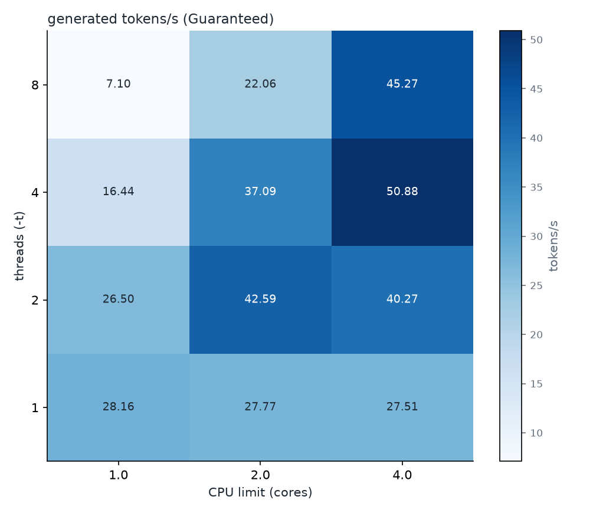
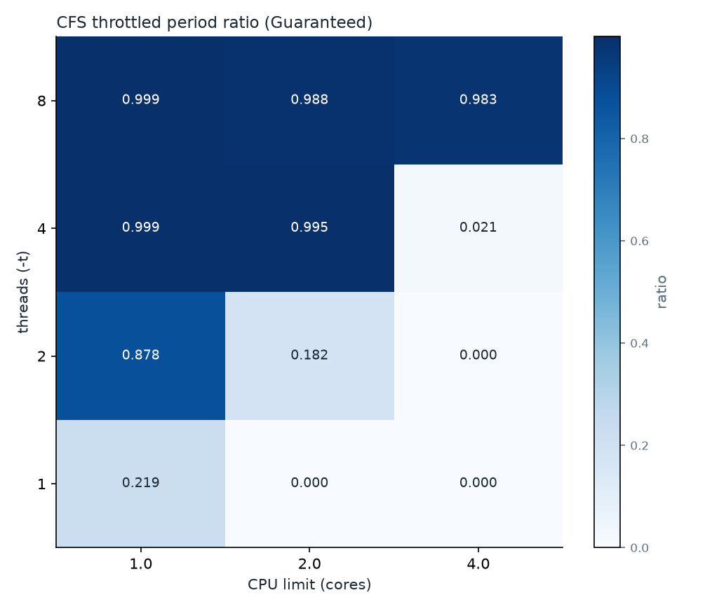
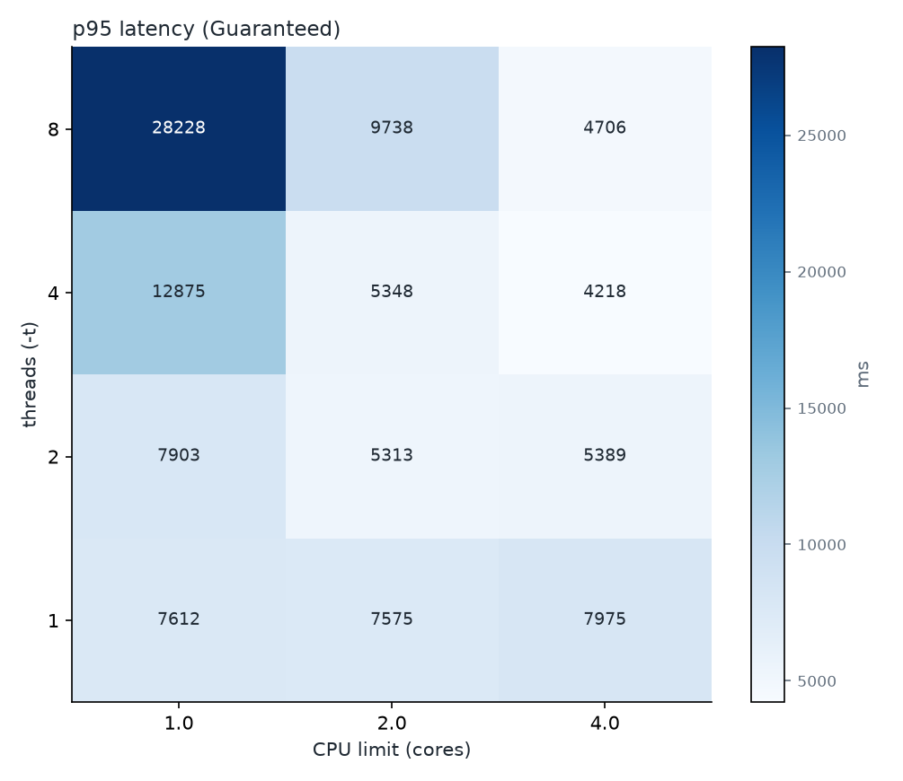

# 스레드 × CPU limit 격자 (Guaranteed, kind on macOS)

생성: 2026-10-14 04:15 UTC

입력: `results/grid-guaranteed-20261014T0334Z/grid.csv`

## 실행 조건

- 기록 시각: 2026-10-14T03:34:40Z
- 입력: `QOS=Guaranteed`
- 입력: `THREADS=1 2 4 8`
- 입력: `LIMITS=1 2 4`
- 입력: `REQUEST_CPU=500m (Burstable일 때만 적용)`
- 입력: `PARALLEL=2`
- 입력: `VUS=2`
- 입력: `DURATION=3m`
- 입력: `EXTRA_VALUES=experiments/values-kind.yaml`
- kubectl 컨텍스트: `kind-cpu-sllm`
- Kubernetes: v1.37.0
- 노드 `cpu-sllm-control-plane`: arm64, 커널 6.8.0-117-generic, containerd://2.3.4, allocatable cpu 8 · memory 8111540Ki, kubelet cpuManagerPolicy·CFS 주기 none 100ms
- 파드 이미지: `cpu-sllm-k8s:kind`, 노드의 imageID `docker.io/library/import-2026-10-14@sha256:38fccef940830a3b963df2d788419014227fafe7195fd4b9687037d867124647`
- llama-server: version: 0.5.0-dev (build 11347, commit 5fc4f3c8c) built with GNU 14.2.0 for Linux aarch64 
- 베이스 이미지(Dockerfile): `ghcr.io/ggml-org/llama.cpp:server-b11347@sha256:970168341efef973da5666ea5c362fa428ee66ba0dfa621b0f69bf3feb3320f7`
- 모델(Dockerfile): Qwen/Qwen2.5-1.5B-Instruct-GGUF `qwen2.5-1.5b-instruct-q4_k_m.gguf`, 커밋 `91cad51170dc346986eccefdc2dd33a9da36ead9`, sha256 `6a1a2eb6d15622bf3c96857206351ba97e1af16c30d7a74ee38970e434e9407e`
- 저장소 커밋: `cf0d4d6`
- 부하 발생 호스트: Darwin arm64, k6 v2.3.0
- 호스트 CPU: Apple M4, 성능 코어 4 + 효율 코어 6, 메모리 16GiB, macOS 26.6.2
- kind: v0.33.0, 노드 이미지 `kindest/node:v1.37.0@sha256:a1ed56cfb0e7b93589bdf97c8cd566405a265939e3620fc4f5de89adff580ae5`
- 로컬 이미지 ID(kind load 원본): `sha256:a4fe6d2104da808c2daf2dd7a1d77312f0d3d46b65f4e3f0e3c57192aa1c9325`
- docker 엔진: 29.5.2, CPU 8개, 메모리 7921MiB
- colima: 0.10.3, macOS Virtualization.Framework vCPU 8 메모리 8 GiB 디스크 40 GiB

Helm 릴리스:

```text
NAME          	NAMESPACE  	CHART                       	APP VERSION
kps           	monitoring 	kube-prometheus-stack-92.3.1	v0.94.1
llm           	llm        	llama-server-0.1.0          	b11347
metrics-server	kube-system	metrics-server-3.14.0       	0.9.0
```

`helm get values llm` (기록 시점의 배포 값. 격자 실험에서는 첫 칸의 값이며 threads와 CPU는 칸마다 바뀐다):

```yaml
autoscaling:
  maxReplicas: 3
image:
  pullPolicy: Never
  repository: cpu-sllm-k8s
  tag: kind
llama:
  parallel: 2
  threads: 1
resources:
  limits:
    cpu: 1
    memory: 2Gi
  requests:
    cpu: 1
    memory: 2Gi
serviceMonitor:
  enabled: true
strategy:
  maxSurge: 0
  maxUnavailable: 1
```

## 스레드 × CPU limit 격자







### Guaranteed

| threads | cpu_limit | requests | tokens_per_s | throttle_ratio | p95_ms | error_rate | cpu_cores |
|---|---|---|---|---|---|---|---|
| 1 | 1.0 | 96 | 28.16 | 0.219 | 7612 | 0.000 | 1.00 |
| 1 | 2.0 | 87 | 27.77 | 0.000 | 7575 | 0.000 | 1.00 |
| 1 | 4.0 | 79 | 27.51 | 0.000 | 7975 | 0.000 | 1.00 |
| 2 | 1.0 | 82 | 26.50 | 0.878 | 7903 | 0.000 | 0.99 |
| 2 | 2.0 | 132 | 42.59 | 0.182 | 5313 | 0.000 | 1.98 |
| 2 | 4.0 | 131 | 40.27 | 0.000 | 5389 | 0.000 | 1.99 |
| 4 | 1.0 | 49 | 16.44 | 0.999 | 12875 | 0.000 | 0.98 |
| 4 | 2.0 | 128 | 37.09 | 0.995 | 5348 | 0.000 | 1.98 |
| 4 | 4.0 | 155 | 50.88 | 0.021 | 4218 | 0.000 | 3.89 |
| 8 | 1.0 | 24 | 7.10 | 0.999 | 28228 | 0.000 | 0.98 |
| 8 | 2.0 | 67 | 22.06 | 0.988 | 9738 | 0.000 | 1.98 |
| 8 | 4.0 | 145 | 45.27 | 0.983 | 4706 | 0.000 | 3.98 |
