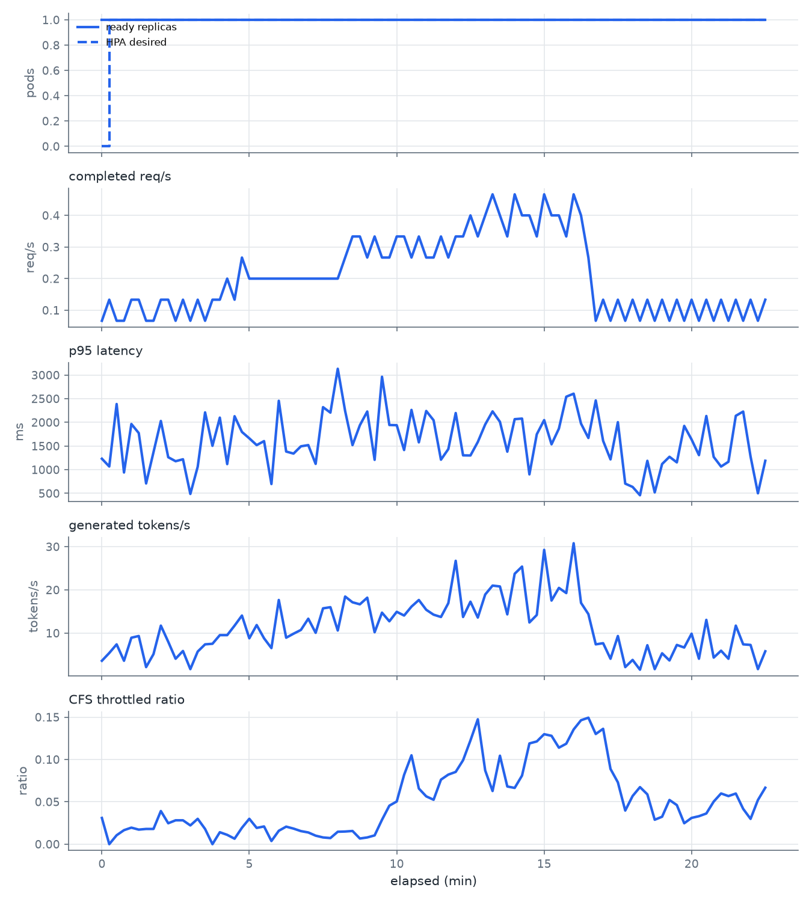

# HPA 계단 부하 (기본 STEPS 6,12,18,24, kind on macOS)

생성: 2026-10-14 07:03 UTC

입력: `results/hpa-20261014T0555Z/timeline.csv`, `results/hpa-20261014T0555Z/steps.csv`, `results/hpa-20261014T0555Z/scale.csv`

## 실행 조건

- 기록 시각: 2026-10-14T05:55:37Z
- 입력: `STEPS=6,12,18,24 (분당 요청 수)`
- 입력: `STEP_DURATION=4m`
- 입력: `RAMP=10s`
- 입력: `COOLDOWN=6m`
- 입력: `EXTRA_VALUES=experiments/values-kind.yaml`
- kubectl 컨텍스트: `kind-cpu-sllm`
- Kubernetes: v1.37.0
- 노드 `cpu-sllm-control-plane`: arm64, 커널 6.8.0-117-generic, containerd://2.3.4, allocatable cpu 8 · memory 8111540Ki, kubelet cpuManagerPolicy·CFS 주기 none 100ms
- 파드 이미지: `cpu-sllm-k8s:kind`, 노드의 imageID `docker.io/library/import-2026-10-14@sha256:38fccef940830a3b963df2d788419014227fafe7195fd4b9687037d867124647`
- llama-server: version: 0.5.0-dev (build 11347, commit 5fc4f3c8c) built with GNU 14.2.0 for Linux aarch64 
- 베이스 이미지(Dockerfile): `ghcr.io/ggml-org/llama.cpp:server-b11347@sha256:970168341efef973da5666ea5c362fa428ee66ba0dfa621b0f69bf3feb3320f7`
- 모델(Dockerfile): Qwen/Qwen2.5-1.5B-Instruct-GGUF `qwen2.5-1.5b-instruct-q4_k_m.gguf`, 커밋 `91cad51170dc346986eccefdc2dd33a9da36ead9`, sha256 `6a1a2eb6d15622bf3c96857206351ba97e1af16c30d7a74ee38970e434e9407e`
- 저장소 커밋: `5267ba7` (커밋하지 않은 변경: README.md, reports/README.md, reports/grid-burstable-20261014T0413Z/, reports/grid-guaranteed-20261014T0334Z/)
- 부하 발생 호스트: Darwin arm64, k6 v2.3.0
- 호스트 CPU: Apple M4, 성능 코어 4 + 효율 코어 6, 메모리 16GiB, macOS 26.6.2
- kind: v0.33.0, 노드 이미지 `kindest/node:v1.37.0@sha256:a1ed56cfb0e7b93589bdf97c8cd566405a265939e3620fc4f5de89adff580ae5`
- 로컬 이미지 ID(kind load 원본): `sha256:a4fe6d2104da808c2daf2dd7a1d77312f0d3d46b65f4e3f0e3c57192aa1c9325`
- docker 엔진: 29.5.2, CPU 8개, 메모리 7921MiB
- colima: 0.10.3, macOS Virtualization.Framework vCPU 8 메모리 8 GiB 디스크 40 GiB

Helm 릴리스:

```text
NAME          	NAMESPACE  	CHART                       	APP VERSION
kps           	monitoring 	kube-prometheus-stack-92.3.1	v0.94.1
llm           	llm        	llama-server-0.1.0          	b11347
metrics-server	kube-system	metrics-server-3.14.0       	0.9.0
```

`helm get values llm` (기록 시점의 배포 값. 격자 실험에서는 첫 칸의 값이며 threads와 CPU는 칸마다 바뀐다):

```yaml
autoscaling:
  enabled: true
  maxReplicas: 3
  minReplicas: 1
  targetCPUUtilizationPercentage: 70
image:
  pullPolicy: Never
  repository: cpu-sllm-k8s
  tag: kind
llama:
  parallel: 2
  threads: 2
resources:
  limits:
    cpu: "2"
    memory: 2Gi
  requests:
    cpu: "2"
    memory: 2Gi
serviceMonitor:
  enabled: true
strategy:
  maxSurge: 0
  maxUnavailable: 1
```

## HPA 계단별 요약

램프 구간을 뺀 계단 구간(start_s~end_s, 부하 시작 기준 초)에 완료된 요청으로 계산했다.
dropped는 k6가 VU를 제때 못 구해 보내지 않고 건너뛴 요청 수(dropped_iterations)다.
레플리카 수는 그 구간의 첫 샘플과 마지막 샘플, cpu_cores와 throttle_ratio는 구간 안 샘플의
평균(전 파드 합)이다.

| step | rate_per_min | start_s | end_s | requests | dropped | completed_per_min | error_rate | p95_ms | tokens_per_s | replicas_ready_start | replicas_ready_end | hpa_desired_max | cpu_cores | throttle_ratio | requests_deferred_max |
|---|---|---|---|---|---|---|---|---|---|---|---|---|---|---|---|
| 1 | 6 | 10 | 250 | 25 | 0 | 6.2 | 0.000 | 2204 | 6.56 | 1 | 1 | 1 | 0.22 | 0.019 | 0 |
| 2 | 12 | 260 | 500 | 48 | 0 | 12.0 | 0.000 | 2308 | 11.43 | 1 | 1 | 1 | 0.49 | 0.015 | 0 |
| 3 | 18 | 510 | 750 | 73 | 0 | 18.2 | 0.000 | 2264 | 15.83 | 1 | 1 | 1 | 0.66 | 0.061 | 0 |
| 4 | 24 | 760 | 1000 | 95 | 0 | 23.8 | 0.000 | 2284 | 19.70 | 1 | 1 | 1 | 0.84 | 0.110 | 0 |
| cooldown | 6 | 1010 | 1370 | 36 | 0 | 6.0 | 0.000 | 2196 | 5.96 | 1 | 1 | 1 | 0.31 | 0.052 | 0 |

## 스케일 시점

elapsed_s는 부하 시작부터 HPA의 lastScaleTime까지, pod_created_s와 pod_ready_s는 그 시점부터
새 파드가 만들어지고 Ready가 되기까지 걸린 초다. 원본 시각이 초 단위라 1초 안팎의 오차가 있다.

이 실행에서는 HPA가 레플리카 수를 바꾸지 않았다.

## HPA 계단 부하 곡선



| elapsed_s | replicas_ready | hpa_desired | rps | p95_ms | tokens_per_s | throttle_ratio | error_rate |
|---|---|---|---|---|---|---|---|
| 0 | 1 | 0 | 0.067 | 1232 | 3.60 | 0.031 | 0.000 |
| 15 | 1 | 1 | 0.133 | 1068 | 5.40 | 0.000 | 0.000 |
| 30 | 1 | 1 | 0.067 | 2388 | 7.40 | 0.011 | 0.000 |
| 45 | 1 | 1 | 0.067 | 941 | 3.60 | 0.017 | 0.000 |
| 60 | 1 | 1 | 0.133 | 1966 | 8.93 | 0.020 | 0.000 |
| 75 | 1 | 1 | 0.133 | 1775 | 9.33 | 0.017 | 0.000 |
| 90 | 1 | 1 | 0.067 | 710 | 2.13 | 0.018 | 0.000 |
| 105 | 1 | 1 | 0.067 | 1370 | 5.13 | 0.018 | 0.000 |
| 120 | 1 | 1 | 0.133 | 2030 | 11.73 | 0.039 | 0.000 |
| 135 | 1 | 1 | 0.133 | 1264 | 8.00 | 0.025 | 0.000 |
| 150 | 1 | 1 | 0.067 | 1179 | 4.07 | 0.028 | 0.000 |
| 165 | 1 | 1 | 0.133 | 1220 | 5.87 | 0.028 | 0.000 |
| 180 | 1 | 1 | 0.067 | 487 | 1.67 | 0.022 | 0.000 |
| 195 | 1 | 1 | 0.133 | 1063 | 5.73 | 0.030 | 0.000 |
| 210 | 1 | 1 | 0.067 | 2211 | 7.40 | 0.018 | 0.000 |
| 225 | 1 | 1 | 0.133 | 1504 | 7.53 | 0.000 | 0.000 |
| 240 | 1 | 1 | 0.133 | 2100 | 9.53 | 0.014 | 0.000 |
| 255 | 1 | 1 | 0.200 | 1118 | 9.53 | 0.011 | 0.000 |
| 270 | 1 | 1 | 0.133 | 2130 | 11.73 | 0.006 | 0.000 |
| 285 | 1 | 1 | 0.267 | 1798 | 14.07 | 0.019 | 0.000 |
| 300 | 1 | 1 | 0.200 | 1663 | 8.80 | 0.030 | 0.000 |
| 315 | 1 | 1 | 0.200 | 1519 | 11.87 | 0.019 | 0.000 |
| 330 | 1 | 1 | 0.200 | 1604 | 8.80 | 0.021 | 0.000 |
| 345 | 1 | 1 | 0.200 | 697 | 6.53 | 0.004 | 0.000 |
| 360 | 1 | 1 | 0.200 | 2456 | 17.67 | 0.016 | 0.000 |
| 375 | 1 | 1 | 0.200 | 1384 | 8.93 | 0.021 | 0.000 |
| 390 | 1 | 1 | 0.200 | 1341 | 9.87 | 0.018 | 0.000 |
| 405 | 1 | 1 | 0.200 | 1494 | 10.73 | 0.015 | 0.000 |
| 420 | 1 | 1 | 0.200 | 1520 | 13.33 | 0.014 | 0.000 |
| 435 | 1 | 1 | 0.200 | 1122 | 10.07 | 0.010 | 0.000 |
| 450 | 1 | 1 | 0.200 | 2322 | 15.73 | 0.008 | 0.000 |
| 465 | 1 | 1 | 0.200 | 2206 | 16.00 | 0.007 | 0.000 |
| 480 | 1 | 1 | 0.200 | 3133 | 10.60 | 0.015 | 0.000 |
| 495 | 1 | 1 | 0.267 | 2240 | 18.47 | 0.015 | 0.000 |
| 510 | 1 | 1 | 0.333 | 1520 | 17.13 | 0.016 | 0.000 |
| 525 | 1 | 1 | 0.333 | 1940 | 16.67 | 0.007 | 0.000 |
| 540 | 1 | 1 | 0.267 | 2230 | 18.20 | 0.008 | 0.000 |
| 555 | 1 | 1 | 0.333 | 1208 | 10.20 | 0.010 | 0.000 |
| 570 | 1 | 1 | 0.267 | 2964 | 14.73 | 0.029 | 0.000 |
| 585 | 1 | 1 | 0.267 | 1944 | 12.73 | 0.045 | 0.000 |
| 600 | 1 | 1 | 0.333 | 1940 | 14.93 | 0.050 | 0.000 |
| 615 | 1 | 1 | 0.333 | 1415 | 14.07 | 0.082 | 0.000 |
| 630 | 1 | 1 | 0.267 | 2263 | 16.13 | 0.105 | 0.000 |
| 645 | 1 | 1 | 0.333 | 1577 | 17.67 | 0.066 | 0.000 |
| 660 | 1 | 1 | 0.267 | 2241 | 15.40 | 0.056 | 0.000 |
| 675 | 1 | 1 | 0.267 | 2045 | 14.27 | 0.052 | 0.000 |
| 690 | 1 | 1 | 0.333 | 1212 | 13.73 | 0.076 | 0.000 |
| 705 | 1 | 1 | 0.267 | 1436 | 16.93 | 0.082 | 0.000 |
| 720 | 1 | 1 | 0.333 | 2197 | 26.73 | 0.085 | 0.000 |
| 735 | 1 | 1 | 0.333 | 1303 | 13.73 | 0.099 | 0.000 |
| 750 | 1 | 1 | 0.400 | 1300 | 17.27 | 0.122 | 0.000 |
| 765 | 1 | 1 | 0.333 | 1586 | 13.60 | 0.147 | 0.000 |
| 780 | 1 | 1 | 0.400 | 1956 | 18.93 | 0.087 | 0.000 |
| 795 | 1 | 1 | 0.467 | 2233 | 21.00 | 0.063 | 0.000 |
| 810 | 1 | 1 | 0.400 | 2012 | 20.80 | 0.104 | 0.000 |
| 825 | 1 | 1 | 0.333 | 1380 | 14.33 | 0.068 | 0.000 |
| 840 | 1 | 1 | 0.467 | 2068 | 23.73 | 0.066 | 0.000 |
| 855 | 1 | 1 | 0.400 | 2080 | 25.40 | 0.081 | 0.000 |
| 870 | 1 | 1 | 0.400 | 901 | 12.47 | 0.119 | 0.000 |
| 885 | 1 | 1 | 0.333 | 1749 | 14.20 | 0.121 | 0.000 |
| 900 | 1 | 1 | 0.467 | 2048 | 29.27 | 0.130 | 0.000 |
| 915 | 1 | 1 | 0.400 | 1537 | 17.53 | 0.128 | 0.000 |
| 930 | 1 | 1 | 0.400 | 1868 | 20.47 | 0.114 | 0.000 |
| 945 | 1 | 1 | 0.333 | 2542 | 19.27 | 0.119 | 0.000 |
| 960 | 1 | 1 | 0.467 | 2607 | 30.80 | 0.135 | 0.000 |
| 975 | 1 | 1 | 0.400 | 1974 | 17.00 | 0.146 | 0.000 |
| 990 | 1 | 1 | 0.267 | 1670 | 14.40 | 0.149 | 0.000 |
| 1005 | 1 | 1 | 0.067 | 2463 | 7.40 | 0.130 | 0.000 |
| 1020 | 1 | 1 | 0.133 | 1609 | 7.67 | 0.136 | 0.000 |
| 1035 | 1 | 1 | 0.067 | 1218 | 4.07 | 0.089 | 0.000 |
| 1050 | 1 | 1 | 0.133 | 2005 | 9.33 | 0.073 | 0.000 |
| 1065 | 1 | 1 | 0.067 | 705 | 2.13 | 0.040 | 0.000 |
| 1080 | 1 | 1 | 0.133 | 636 | 3.80 | 0.057 | 0.000 |
| 1095 | 1 | 1 | 0.067 | 460 | 1.53 | 0.067 | 0.000 |
| 1110 | 1 | 1 | 0.133 | 1188 | 7.20 | 0.059 | 0.000 |
| 1125 | 1 | 1 | 0.067 | 520 | 1.67 | 0.029 | 0.000 |
| 1140 | 1 | 1 | 0.133 | 1120 | 5.33 | 0.032 | 0.000 |
| 1155 | 1 | 1 | 0.067 | 1273 | 3.67 | 0.052 | 0.000 |
| 1170 | 1 | 1 | 0.133 | 1155 | 7.27 | 0.046 | 0.000 |
| 1185 | 1 | 1 | 0.067 | 1925 | 6.67 | 0.025 | 0.000 |
| 1200 | 1 | 1 | 0.133 | 1638 | 9.87 | 0.031 | 0.000 |
| 1215 | 1 | 1 | 0.067 | 1308 | 4.07 | 0.033 | 0.000 |
| 1230 | 1 | 1 | 0.133 | 2135 | 13.07 | 0.036 | 0.000 |
| 1245 | 1 | 1 | 0.067 | 1270 | 4.33 | 0.050 | 0.000 |
| 1260 | 1 | 1 | 0.133 | 1067 | 5.93 | 0.060 | 0.000 |
| 1275 | 1 | 1 | 0.067 | 1167 | 4.07 | 0.057 | 0.000 |
| 1290 | 1 | 1 | 0.133 | 2139 | 11.73 | 0.060 | 0.000 |
| 1305 | 1 | 1 | 0.067 | 2229 | 7.40 | 0.042 | 0.000 |
| 1320 | 1 | 1 | 0.133 | 1279 | 7.27 | 0.030 | 0.000 |
| 1335 | 1 | 1 | 0.067 | 501 | 1.67 | 0.052 | 0.000 |
| 1350 | 1 | 1 | 0.133 | 1189 | 5.80 | 0.067 | 0.000 |
