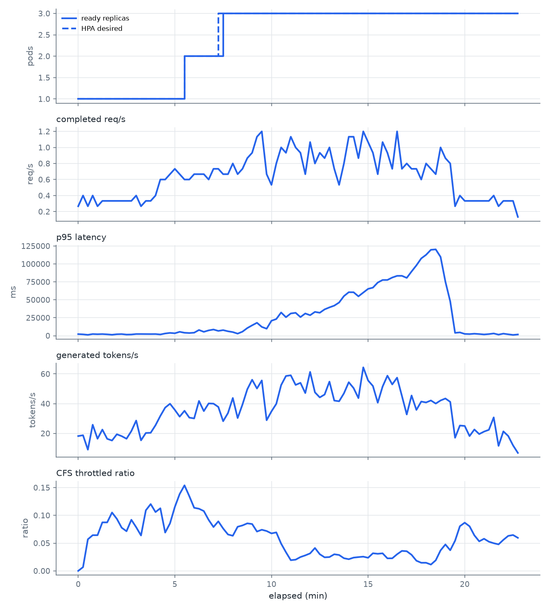

# HPA 계단 부하 (STEPS 20,40,60,80, kind on macOS)

생성: 2026-10-14 07:03 UTC

입력: `results/hpa-steps20-20261014T0634Z/timeline.csv`, `results/hpa-steps20-20261014T0634Z/steps.csv`, `results/hpa-steps20-20261014T0634Z/scale.csv`

## 실행 조건

- 기록 시각: 2026-10-14T06:38:34Z
- 입력: `STEPS=20,40,60,80 (분당 요청 수)`
- 입력: `STEP_DURATION=4m`
- 입력: `RAMP=10s`
- 입력: `COOLDOWN=6m`
- 입력: `EXTRA_VALUES=experiments/values-kind.yaml`
- kubectl 컨텍스트: `kind-cpu-sllm`
- Kubernetes: v1.37.0
- 노드 `cpu-sllm-control-plane`: arm64, 커널 6.8.0-117-generic, containerd://2.3.4, allocatable cpu 8 · memory 8111540Ki, kubelet cpuManagerPolicy·CFS 주기 none 100ms
- 파드 이미지: `cpu-sllm-k8s:kind`, 노드의 imageID `docker.io/library/import-2026-10-14@sha256:38fccef940830a3b963df2d788419014227fafe7195fd4b9687037d867124647`
- llama-server: version: 0.5.0-dev (build 11347, commit 5fc4f3c8c) built with GNU 14.2.0 for Linux aarch64 
- 베이스 이미지(Dockerfile): `ghcr.io/ggml-org/llama.cpp:server-b11347@sha256:970168341efef973da5666ea5c362fa428ee66ba0dfa621b0f69bf3feb3320f7`
- 모델(Dockerfile): Qwen/Qwen2.5-1.5B-Instruct-GGUF `qwen2.5-1.5b-instruct-q4_k_m.gguf`, 커밋 `91cad51170dc346986eccefdc2dd33a9da36ead9`, sha256 `6a1a2eb6d15622bf3c96857206351ba97e1af16c30d7a74ee38970e434e9407e`
- 저장소 커밋: `884ddee` (커밋하지 않은 변경: README.md, reports/README.md, reports/grid-burstable-20261014T0413Z/, reports/grid-guaranteed-20261014T0334Z/, reports/grid-guaranteed-repeat-20261014T0619Z/, reports/hpa-20261014T0555Z/, scripts/host_power.sh)
- 부하 발생 호스트: Darwin arm64, k6 v2.3.0
- 호스트 CPU: Apple M4, 성능 코어 4 + 효율 코어 6, 메모리 16GiB, macOS 26.6.2
- kind: v0.33.0, 노드 이미지 `kindest/node:v1.37.0@sha256:a1ed56cfb0e7b93589bdf97c8cd566405a265939e3620fc4f5de89adff580ae5`
- 로컬 이미지 ID(kind load 원본): `sha256:a4fe6d2104da808c2daf2dd7a1d77312f0d3d46b65f4e3f0e3c57192aa1c9325`
- docker 엔진: 29.5.2, CPU 8개, 메모리 7921MiB
- colima: 0.10.3, macOS Virtualization.Framework vCPU 8 메모리 8 GiB 디스크 40 GiB

Helm 릴리스:

```text
NAME          	NAMESPACE  	CHART                       	APP VERSION
kps           	monitoring 	kube-prometheus-stack-92.3.1	v0.94.1
llm           	llm        	llama-server-0.1.0          	b11347
metrics-server	kube-system	metrics-server-3.14.0       	0.9.0
```

`helm get values llm` (기록 시점의 배포 값. 격자 실험에서는 첫 칸의 값이며 threads와 CPU는 칸마다 바뀐다):

```yaml
autoscaling:
  enabled: true
  maxReplicas: 3
  minReplicas: 1
  targetCPUUtilizationPercentage: 70
image:
  pullPolicy: Never
  repository: cpu-sllm-k8s
  tag: kind
llama:
  parallel: 2
  threads: 2
resources:
  limits:
    cpu: "2"
    memory: 2Gi
  requests:
    cpu: "2"
    memory: 2Gi
serviceMonitor:
  enabled: true
strategy:
  maxSurge: 0
  maxUnavailable: 1
```

## HPA 계단별 요약

램프 구간을 뺀 계단 구간(start_s~end_s, 부하 시작 기준 초)에 완료된 요청으로 계산했다.
dropped는 k6가 VU를 제때 못 구해 보내지 않고 건너뛴 요청 수(dropped_iterations)다.
레플리카 수는 그 구간의 첫 샘플과 마지막 샘플, cpu_cores와 throttle_ratio는 구간 안 샘플의
평균(전 파드 합)이다.

| step | rate_per_min | start_s | end_s | requests | dropped | completed_per_min | error_rate | p95_ms | tokens_per_s | replicas_ready_start | replicas_ready_end | hpa_desired_max | cpu_cores | throttle_ratio | requests_deferred_max |
|---|---|---|---|---|---|---|---|---|---|---|---|---|---|---|---|
| 1 | 20 | 10 | 250 | 80 | 0 | 20.0 | 0.000 | 2420 | 19.29 | 1 | 1 | 1 | 0.76 | 0.082 | 0 |
| 2 | 40 | 260 | 500 | 160 | 0 | 40.0 | 0.000 | 7330 | 35.40 | 1 | 3 | 3 | 2.62 | 0.099 | 0 |
| 3 | 60 | 510 | 750 | 216 | 3 | 54.0 | 0.000 | 29855 | 49.20 | 3 | 3 | 3 | 4.79 | 0.050 | 15 |
| 4 | 80 | 760 | 1000 | 222 | 49 | 55.5 | 0.000 | 77693 | 50.74 | 3 | 3 | 3 | 5.74 | 0.026 | 64 |
| cooldown | 20 | 1010 | 1370 | 192 | 0 | 32.0 | 0.000 | 109774 | 29.86 | 3 | 3 | 3 | 3.12 | 0.048 | 67 |

## 스케일 시점

elapsed_s는 부하 시작부터 HPA의 lastScaleTime까지, pod_created_s와 pod_ready_s는 그 시점부터
새 파드가 만들어지고 Ready가 되기까지 걸린 초다. 원본 시각이 초 단위라 1초 안팎의 오차가 있다.

| elapsed_s | direction | from_replicas | to_replicas | pod_created_s | pod_ready_s |
|---|---|---|---|---|---|
| 308 | up | 1 | 2 | 0 | 5 |
| 413 | up | 2 | 3 | 0 | 15 |

## HPA 계단 부하 곡선



| elapsed_s | replicas_ready | hpa_desired | rps | p95_ms | tokens_per_s | throttle_ratio | error_rate |
|---|---|---|---|---|---|---|---|
| 0 | 1 | 1 | 0.267 | 2211 | 18.20 | 0.000 | 0.000 |
| 15 | 1 | 1 | 0.400 | 1862 | 18.73 | 0.007 | 0.000 |
| 30 | 1 | 1 | 0.267 | 1225 | 9.07 | 0.057 | 0.000 |
| 45 | 1 | 1 | 0.400 | 2303 | 25.80 | 0.064 | 0.000 |
| 60 | 1 | 1 | 0.267 | 2055 | 16.40 | 0.064 | 0.000 |
| 75 | 1 | 1 | 0.333 | 2264 | 22.53 | 0.087 | 0.000 |
| 90 | 1 | 1 | 0.333 | 1873 | 16.33 | 0.087 | 0.000 |
| 105 | 1 | 1 | 0.333 | 1340 | 15.20 | 0.105 | 0.000 |
| 120 | 1 | 1 | 0.333 | 2041 | 19.40 | 0.094 | 0.000 |
| 135 | 1 | 1 | 0.333 | 2249 | 18.13 | 0.078 | 0.000 |
| 150 | 1 | 1 | 0.333 | 1559 | 16.40 | 0.071 | 0.000 |
| 165 | 1 | 1 | 0.333 | 1674 | 21.53 | 0.092 | 0.000 |
| 180 | 1 | 1 | 0.400 | 2335 | 28.60 | 0.079 | 0.000 |
| 195 | 1 | 1 | 0.267 | 2335 | 15.33 | 0.064 | 0.000 |
| 210 | 1 | 1 | 0.333 | 2282 | 20.27 | 0.109 | 0.000 |
| 225 | 1 | 1 | 0.333 | 2238 | 20.40 | 0.120 | 0.000 |
| 240 | 1 | 1 | 0.400 | 2298 | 25.47 | 0.106 | 0.000 |
| 255 | 1 | 1 | 0.600 | 1710 | 31.73 | 0.113 | 0.000 |
| 270 | 1 | 1 | 0.600 | 3085 | 37.33 | 0.069 | 0.000 |
| 285 | 1 | 1 | 0.667 | 3908 | 39.93 | 0.086 | 0.000 |
| 300 | 1 | 1 | 0.733 | 3372 | 35.80 | 0.115 | 0.000 |
| 315 | 1 | 1 | 0.667 | 5435 | 31.27 | 0.138 | 0.000 |
| 330 | 2 | 2 | 0.600 | 4106 | 35.20 | 0.154 | 0.000 |
| 345 | 2 | 2 | 0.600 | 3745 | 30.60 | 0.135 | 0.000 |
| 360 | 2 | 2 | 0.667 | 4218 | 30.07 | 0.114 | 0.000 |
| 375 | 2 | 2 | 0.667 | 7961 | 41.80 | 0.112 | 0.000 |
| 390 | 2 | 2 | 0.667 | 5400 | 35.00 | 0.108 | 0.000 |
| 405 | 2 | 2 | 0.600 | 7422 | 40.13 | 0.092 | 0.000 |
| 420 | 2 | 2 | 0.733 | 8628 | 40.00 | 0.079 | 0.000 |
| 435 | 2 | 3 | 0.733 | 6690 | 37.80 | 0.089 | 0.000 |
| 450 | 3 | 3 | 0.667 | 7784 | 28.20 | 0.076 | 0.000 |
| 465 | 3 | 3 | 0.667 | 6159 | 33.67 | 0.066 | 0.000 |
| 480 | 3 | 3 | 0.800 | 5040 | 43.80 | 0.063 | 0.000 |
| 495 | 3 | 3 | 0.667 | 2876 | 30.33 | 0.079 | 0.000 |
| 510 | 3 | 3 | 0.733 | 5650 | 39.40 | 0.082 | 0.000 |
| 525 | 3 | 3 | 0.867 | 10664 | 49.67 | 0.086 | 0.000 |
| 540 | 3 | 3 | 0.933 | 14462 | 56.07 | 0.084 | 0.000 |
| 555 | 3 | 3 | 1.133 | 18017 | 50.20 | 0.071 | 0.000 |
| 570 | 3 | 3 | 1.200 | 12264 | 55.60 | 0.074 | 0.000 |
| 585 | 3 | 3 | 0.667 | 9768 | 28.87 | 0.072 | 0.000 |
| 600 | 3 | 3 | 0.533 | 20839 | 34.80 | 0.068 | 0.000 |
| 615 | 3 | 3 | 0.800 | 23232 | 39.87 | 0.069 | 0.000 |
| 630 | 3 | 3 | 1.000 | 32334 | 52.47 | 0.049 | 0.000 |
| 645 | 3 | 3 | 0.933 | 25793 | 58.60 | 0.034 | 0.000 |
| 660 | 3 | 3 | 1.133 | 31014 | 59.07 | 0.019 | 0.000 |
| 675 | 3 | 3 | 1.000 | 31910 | 52.60 | 0.020 | 0.000 |
| 690 | 3 | 3 | 0.933 | 25954 | 54.00 | 0.025 | 0.000 |
| 705 | 3 | 3 | 0.667 | 30971 | 47.13 | 0.028 | 0.000 |
| 720 | 3 | 3 | 1.067 | 28548 | 61.33 | 0.032 | 0.000 |
| 735 | 3 | 3 | 0.800 | 33182 | 47.60 | 0.041 | 0.000 |
| 750 | 3 | 3 | 0.933 | 31995 | 44.20 | 0.030 | 0.000 |
| 765 | 3 | 3 | 0.867 | 36686 | 46.13 | 0.024 | 0.000 |
| 780 | 3 | 3 | 1.000 | 39466 | 54.80 | 0.025 | 0.000 |
| 795 | 3 | 3 | 0.733 | 41907 | 42.07 | 0.030 | 0.000 |
| 810 | 3 | 3 | 0.533 | 46242 | 41.60 | 0.029 | 0.000 |
| 825 | 3 | 3 | 0.800 | 55192 | 46.93 | 0.023 | 0.000 |
| 840 | 3 | 3 | 1.133 | 60609 | 54.40 | 0.021 | 0.000 |
| 855 | 3 | 3 | 1.133 | 60539 | 50.47 | 0.024 | 0.000 |
| 870 | 3 | 3 | 0.867 | 54866 | 43.73 | 0.025 | 0.000 |
| 885 | 3 | 3 | 1.200 | 60091 | 64.40 | 0.026 | 0.000 |
| 900 | 3 | 3 | 1.067 | 65263 | 55.60 | 0.024 | 0.000 |
| 915 | 3 | 3 | 0.933 | 67003 | 51.87 | 0.032 | 0.000 |
| 930 | 3 | 3 | 0.667 | 74068 | 40.67 | 0.031 | 0.000 |
| 945 | 3 | 3 | 1.067 | 77629 | 51.47 | 0.032 | 0.000 |
| 960 | 3 | 3 | 0.933 | 77679 | 58.80 | 0.023 | 0.000 |
| 975 | 3 | 3 | 0.733 | 81057 | 52.93 | 0.023 | 0.000 |
| 990 | 3 | 3 | 1.200 | 83392 | 57.47 | 0.030 | 0.000 |
| 1005 | 3 | 3 | 0.733 | 83453 | 45.20 | 0.036 | 0.000 |
| 1020 | 3 | 3 | 0.800 | 80576 | 32.73 | 0.035 | 0.000 |
| 1035 | 3 | 3 | 0.733 | 89493 | 45.47 | 0.029 | 0.000 |
| 1050 | 3 | 3 | 0.733 | 98035 | 35.80 | 0.018 | 0.000 |
| 1065 | 3 | 3 | 0.600 | 107694 | 41.40 | 0.015 | 0.000 |
| 1080 | 3 | 3 | 0.800 | 112704 | 40.80 | 0.015 | 0.000 |
| 1095 | 3 | 3 | 0.733 | 119716 | 42.13 | 0.011 | 0.000 |
| 1110 | 3 | 3 | 0.667 | 120275 | 40.07 | 0.019 | 0.000 |
| 1125 | 3 | 3 | 1.000 | 109784 | 42.13 | 0.037 | 0.000 |
| 1140 | 3 | 3 | 0.867 | 75324 | 43.47 | 0.048 | 0.000 |
| 1155 | 3 | 3 | 0.800 | 47847 | 41.20 | 0.037 | 0.000 |
| 1170 | 3 | 3 | 0.267 | 3977 | 17.07 | 0.054 | 0.000 |
| 1185 | 3 | 3 | 0.400 | 4601 | 25.27 | 0.080 | 0.000 |
| 1200 | 3 | 3 | 0.333 | 2482 | 25.00 | 0.087 | 0.000 |
| 1215 | 3 | 3 | 0.333 | 2269 | 18.20 | 0.080 | 0.000 |
| 1230 | 3 | 3 | 0.333 | 2761 | 22.60 | 0.064 | 0.000 |
| 1245 | 3 | 3 | 0.333 | 2312 | 19.53 | 0.053 | 0.000 |
| 1260 | 3 | 3 | 0.333 | 1730 | 21.20 | 0.058 | 0.000 |
| 1275 | 3 | 3 | 0.333 | 2267 | 22.40 | 0.053 | 0.000 |
| 1290 | 3 | 3 | 0.400 | 3106 | 30.73 | 0.050 | 0.000 |
| 1305 | 3 | 3 | 0.267 | 1503 | 11.60 | 0.048 | 0.000 |
| 1320 | 3 | 3 | 0.333 | 2863 | 21.33 | 0.056 | 0.000 |
| 1335 | 3 | 3 | 0.333 | 1941 | 18.27 | 0.063 | 0.000 |
| 1350 | 3 | 3 | 0.333 | 1102 | 11.93 | 0.065 | 0.000 |
| 1365 | 3 | 3 | 0.133 | 1703 | 6.87 | 0.060 | 0.000 |
